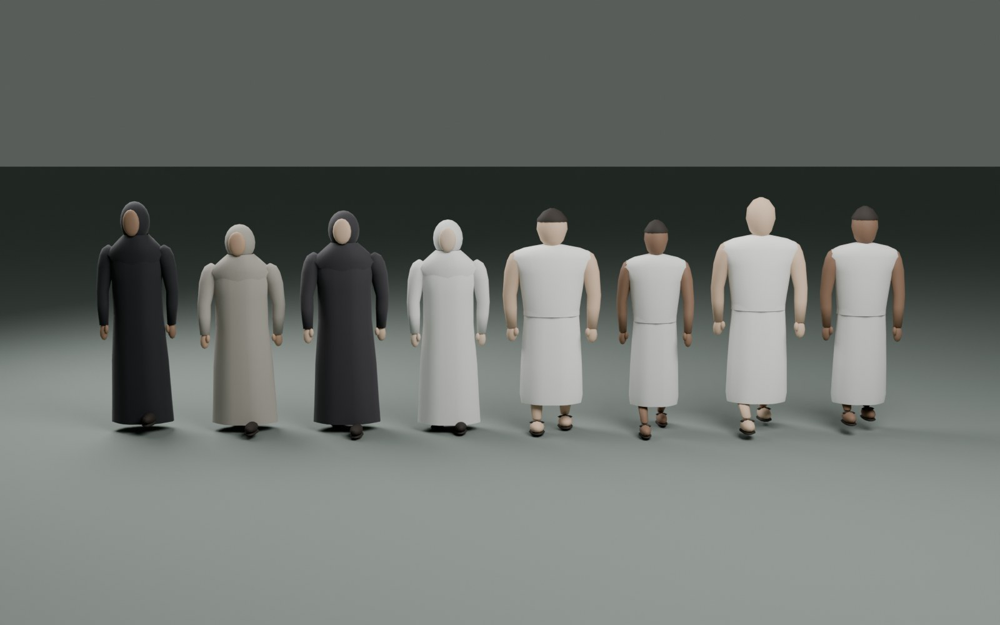
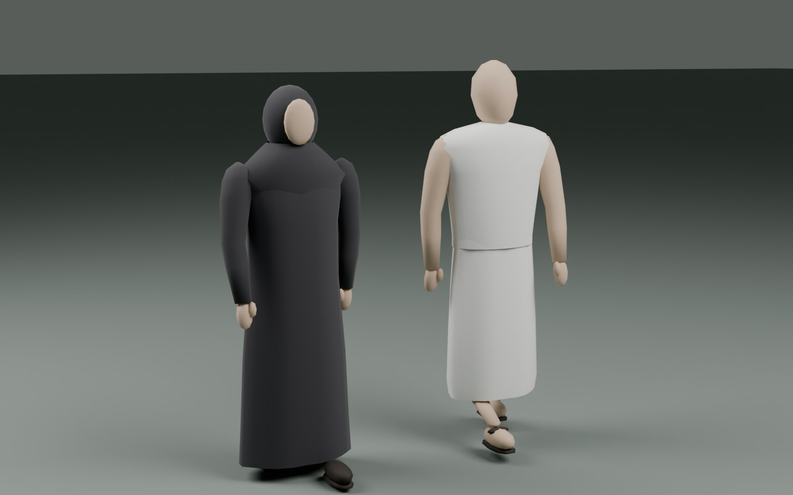
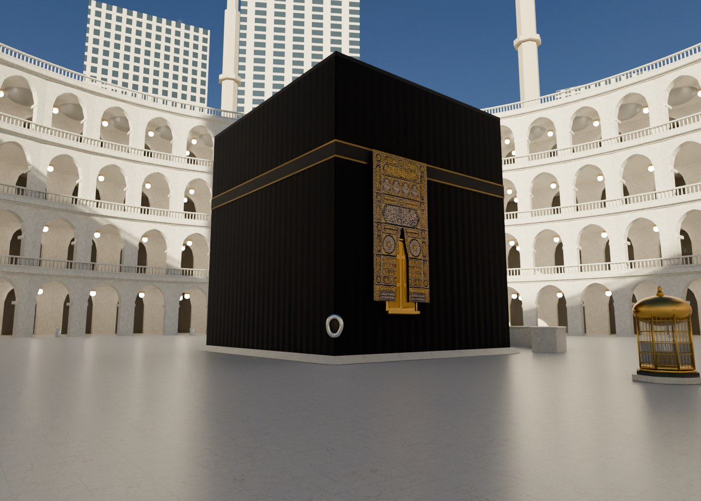
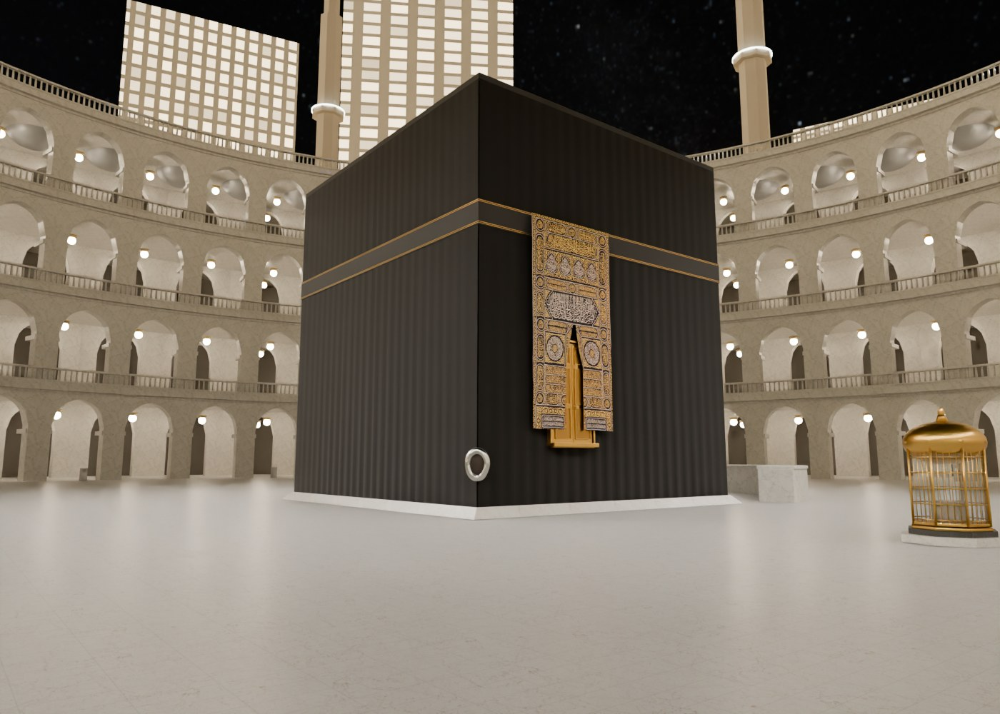
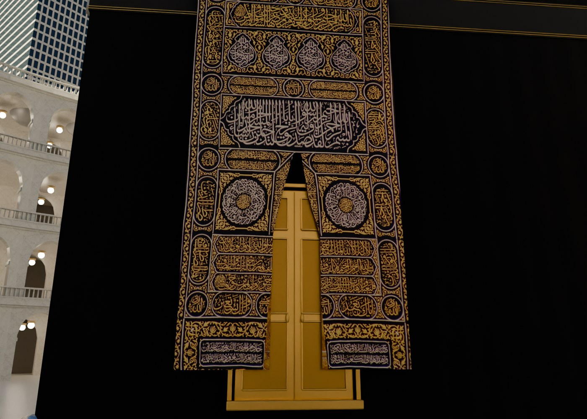
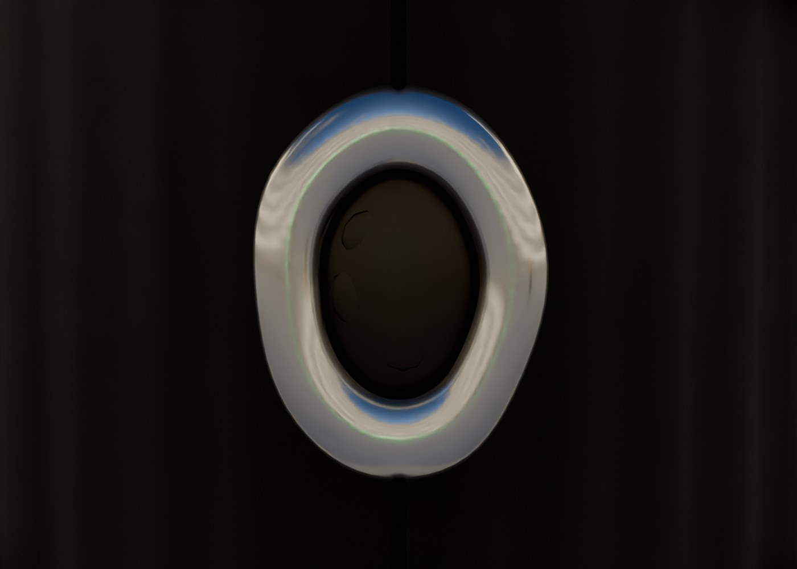
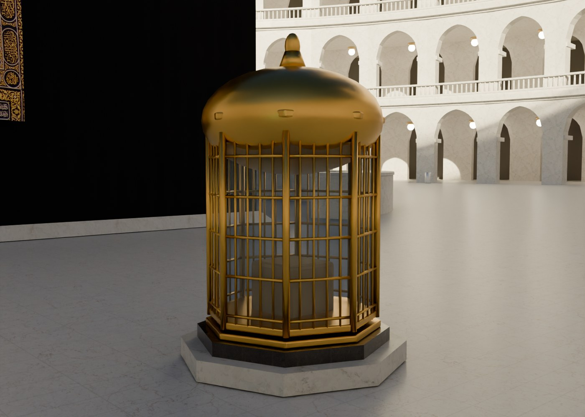

# Kaaba visual milestone — 23 October 2026

Implemented the first section of the [visual authenticity plan](3d-visual-authenticity-plan.md).
The user-requested crowd pass is included. The wider Haram/Mas'a reconstruction
and further clothing/animation refinement are still pending.

## What is ready to review

- Shared Kaaba-area geometry for the 360° tour and real-time scene: draped cloth,
  sloping marble base, separate door and curtain, recessed Black Stone/silver
  surround, Hijr coping and an open Maqam enclosure.
- A documented CC0 photograph supplies the curtain's original Arabic. The source
  is dated 2016; remaining embroidery regions are reserved. No Arabic lettering
  was generated, mirrored or AI-restyled.
- Normal and metallic/roughness textures survive glTF export and browser setup.
  Static contact shading was baked without crowds. Marble reflections are softer.
- Distinct daylight and roof-floodlight night profiles in the browser, with one
  active shadow source. Shorter learning markers reduce obstruction.
- Shared layout data for Blender and browser targets/collisions; existing lesson
  coordinates remain intact. Mas'a crowds turn at the ends instead of wrapping
  directly from one hill to the other. Reduced-motion crowds are placed statically.
- Eight new pilgrim silhouettes replace the four cone-based figures. Profiled
  robes, shoulders, simple heads, arms, hands, calves and footwear share masters
  between both tours. Browser foot recovery paths keep ankles under the garment;
  opposing arm motion and matching shadow poses use instanced vertex shaders.
  Heights, builds, skin tones, clothing and phase vary. Faces remain simple.
- Versioned model URLs prevent stale models after a visual update. Vertex
  quantization and batching preserve instancing and reduce download sizes.
- World transitions release old environment textures, geometry and instance
  buffers; the small crowd prototype geometry stays shared for reuse.

## Delivery assets

| Asset | Before | After | Unique triangles after |
|---|---:|---:|---:|
| Haram | 8,598,520 bytes | 7,769,724 bytes | 132,462 |
| Mas'a | 3,153,700 bytes | 2,360,588 bytes | 32,856 |
| Pilgrims | 37,736 bytes | 352,392 bytes | 15,396 |

Triangle counts are unique mesh geometry, not total work per frame. Actual rendered
geometry depends on instances, visible surfaces and shadow passes. See the
[asset report](visual-asset-report.json).

Estimated RGBA8 texture storage including mipmaps is 68.67 MiB for the Haram
and 48.00 MiB for the Mas'a. Only the active world is kept resident after a
transition. These source-image estimates exclude shadow maps, sky/environment
maps, framebuffers and driver overhead; they are not physical GPU measurements.

The rented NVIDIA H100 PCIe produced thirteen 4096 × 2048 panoramas (ten Haram,
three Mas'a), ten fixed 1400 × 1000 landmark views and two 1600 × 1000 crowd
reviews at 64 Cycles samples. The contact bake excludes people. Output verification
and worker deletion are recorded in the [render receipt](visual-render-receipt.json).
All 51 output files passed SHA-256 checks. Both rented workers were deleted
and their absence verified through Hyperstack. The GPU elapsed-time estimate for
both workers, including draft/repair renders, is $2.97 at $2/hour;
this is not a provider invoice or an estimate of other charges.

## Validation

- 25 JavaScript and 9 Python regression tests passed, including counters, saved
  sessions, stale loads/audio, retry behavior, material-map preservation and
  continuous Mas'a crowd turns and releasing shared GPU resources once.
- Clean build and fresh-output hash checks passed. Asset checks verify normals,
  texture UVs, cloth/roughness channels, roles, instancing and download budgets.
  A regression check rejects horizontally mirrored curtain artwork; every crowd
  primitive must retain its custom gait attributes.
- Browser inspection confirmed the quantized landmarks, day/night lighting and
  load/reload behavior. The previous unversioned-model cache issue was reproduced
  and fixed.
- The browser walkthrough completed all seven Tawaf circuits and progressed
  through Maqam, Zamzam and the deferred Mas'a transition to Safa.
- Browser diagnostics are available with `explore.html?stats`. With the new
  crowd, desktop in-app preview samples showed about 111–138 draw calls and
  2.33–2.34 million rendered triangles at DPR 2, around 120 FPS in this preview.
  Low data changes rebuild the crowd immediately: the same view dropped to
  roughly 0.78 million rendered triangles at DPR 1. These are scene observations,
  not a benchmark for a specified GPU or phone.
- In the updated walkthrough, the Haram → Mas'a transition lowered renderer
  texture count from 22 to 18, including lesson overlays, while the old crowd
  and world buffers were released.

Actual Android/iPhone testing, fixed 1080p desktop benchmarking, physical GPU
memory measurements and a measured ten-minute stability pass remain open.

## Review views

The local preview gallery at `/visual-review/` switches the same five camera views
between daylight and floodlit night, and includes the eight-variant crowd lineup
and clothing close-up. Full-resolution source images are in
`docs/visual-review/`.

## Remaining authenticity work

The [reference ledger](visual-reference-ledger.md) distinguishes supported details
from approximations. Complete the dated kiswa/hizam artwork and Arabic review,
then refine surveyed proportions and landmark offsets. The arcade rings, minaret
positions, skyline, Safa/Marwah and corridor kit still need the later architectural
phases. The crowd now has shaped silhouettes and limb animation; close-range facial
detail, more precise garment draping and further gait refinement remain open. No specialist authenticity review is marked complete.
